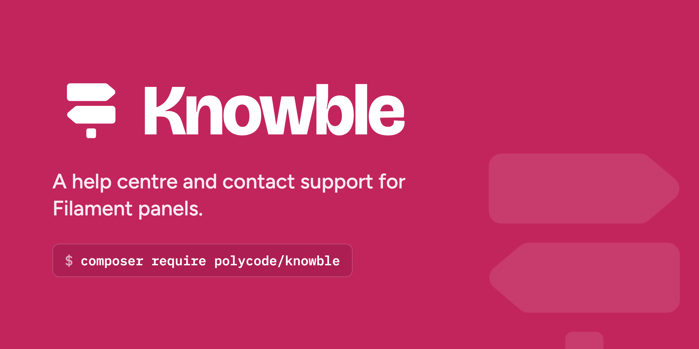

# Knowble support

Questions, bug reports and ideas for [Knowble](https://www.knowble.co.nz), the help centre and contact support plugin for Filament panels. Knowble's code is
private, so this repository holds no code: it's where you reach us.

- **Something's broken:** [open an issue](https://github.com/polycode-nz/knowble-support/issues/new/choose).
  Include your Knowble, Filament, Laravel and PHP versions, and the steps that show it.
- **A question, or how to do something:** ask in
  [Discussions](https://github.com/polycode-nz/knowble-support/discussions). Someone else may have asked
  already.
- **An idea for Knowble:** post it in Discussions under Ideas.
- **A security problem:** email hello@polycode.co.nz. Please don't open a public issue for it.
- **Your licence, an invoice or a refund:** email hello@polycode.co.nz.

The [docs](https://www.knowble.co.nz/docs) cover installing and every setting, and the
[changelog](https://www.knowble.co.nz/changelog) says what each release changed.
